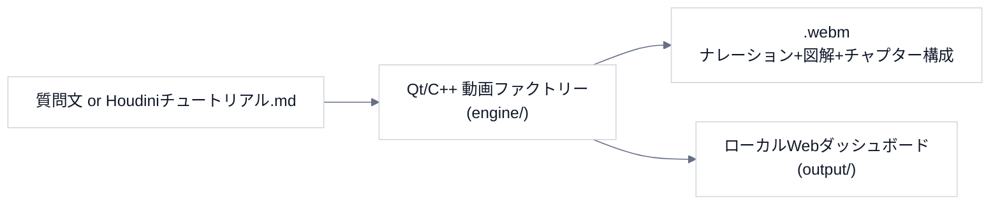

# RAGReel

質問文(または Houdini のチュートリアル `.md`)を渡すと、スライド・音声ナレーション・図解つきのチュートリアル動画(`.webm`)を自動で作り、ローカルの Web ダッシュボードに並べる Qt/C++ 製のヘッドレスエンジン(**RAG駆動チュートリアル動画生成ファクトリー**)。

> このリポジトリは「Qtの学習兼各言語の比較」が目的で、その学習の題材としてこのファクトリーを実装しています。



- **`video_factory_cloudrag_poc.exe`** — CLI バッチツール本体(動画を作る)
- **`RAGReel.exe`** — 非エンジニア向けの GUI ランチャー(上の exe をサブプロセスとして起動するだけの薄いラッパー)

## 何ができるか

- **質問から動画へ**: 質問文と `dbKey` から Cloud RAG の回答と出典を取り、スライド・ナレーション・図解つきの動画(VP9 + Opus の `.webm`)にする
- **Houdini のチュートリアルから動画へ**: `--houdini-md` で `.md`(と任意で `.json`・手順の画面・初心者向け台本)を渡すと、手順ごとの画面と声つきの動画にする
- **声を選ぶ**: ナレーションは クラウド音声 → VOICEVOX → SAPI(Windows 標準)の順に使える声を選ぶ。字幕(`.vtt`)と章(chapters)も書き出す
- **見る・共有する**: 動画は `output/` のダッシュボードで見られる。任意で共有ギャラリー(Cloudflare Worker + R2)へ送れる
- **APIキー無しでも試せる**: `--mock` で、通信なしに最後まで動かせる

## クイックスタート

要るもの: Windows 11 + Visual Studio 2022・CMake 3.24+ / Ninja・vcpkg(`C:/vcpkg`)。詳細は [docs/getting-started.md](docs/getting-started.md)。

```powershell
cmake --preset default
cmake --build --preset default          # 初回は Qt6 / FFmpeg のビルドで数十分かかることがある
cd build\engine
.\video_factory_cloudrag_poc.exe "テストトピック" houdini21 --mock    # APIキー不要
```

終わると同じフォルダの `output/` に動画とダッシュボードが出る。`output/gallery.html` をブラウザで開く。GUI は `.\RAGReel.exe`。単体テストは `cd build; ctest --output-on-failure`。実際の Cloud RAG へつなぐ手順・Houdini の取り込み・テスト全般は [docs/getting-started.md](docs/getting-started.md)。

## 図の一覧

図は `docs/diagrams/*.svg`(ライト/ダークの両方に追従)。再生成は `python tools/build_diagrams.py`。

| 図 | 何を示すか |
|---|---|
| [system-overview](docs/diagrams/system-overview.svg) | 全体像: 利用者の PC・Cloudflare・閲覧者の関係と、①〜⑦の流れ |
| [generation-sequence](docs/diagrams/generation-sequence.svg) | 動画 1 本ができるまでの、誰が誰に何を頼むかの時間順(シーケンス図) |
| [pipeline-flow](docs/diagrams/pipeline-flow.svg) | エンジン内の 7 段(取り込み〜公開)と、各段の成果物・GPU リース |
| [input-modes](docs/diagrams/input-modes.svg) | 引数で、Houdini・モック・Cloud RAG のどれを元にするか決まる分岐 |
| [engine-structure](docs/diagrams/engine-structure.svg) | `engine/src/` の部品と依存の向き(コードを読む人の地図) |
| [narration-backend](docs/diagrams/narration-backend.svg) | ナレーションの声(クラウド / VOICEVOX / SAPI)の選び方 |
| [output-layout](docs/diagrams/output-layout.svg) | `output/` に何が置かれ、誰が書き、誰が読むか |
| [dashboard-loading](docs/diagrams/dashboard-loading.svg) | `file://` と `https` で、manifest / metadata の読み方が変わる分岐 |
| [cloud-gallery](docs/diagrams/cloud-gallery.svg) | 共有ギャラリー(Worker + R2)へのアップロードと閲覧 |
| [compare-three-ways](docs/diagrams/compare-three-ways.svg) | 同じ入力を Qt / HyperFrames / Python の 3 方式で動画にした比較 |

<details>
<summary>流れの Mermaid 版(テキストで差分が取れる簡易図)</summary>



</details>

## ドキュメント

| 用途 | ドキュメント | 内容 |
|---|---|---|
| **まず読む** | [docs/learn/README.md](docs/learn/README.md) | **学習資料**(第1〜17章。言語・アルゴリズム・ビルドの基礎から、保守・拡張の手順、演習、トラブルシュートまで講義形式)。迷ったらここから |
| 動かす | [docs/getting-started.md](docs/getting-started.md) | 必要環境・ビルド・動作確認(`--mock`・GUI・実接続・単体テスト) |
| 動かす | [docs/verify-export.md](docs/verify-export.md) | 書き出した動画を測る検査(`tools/verify_export.py`) |
| 仕組みを知る | [docs/technical-reference.md](docs/technical-reference.md) | 実装済み内容の技術リファレンス(図解込み)。最新の実装状況はこちらが正 |
| 仕組みを知る | [docs/architecture/video-factory-design.md](docs/architecture/video-factory-design.md) | 初期アーキテクチャ設計(Phase 0)。§10に実装との乖離・追補あり |
| 仕組みを知る | [docs/diagrams/](docs/diagrams/) | 構成図・フローチャート・シーケンス図(SVG 10枚) |
| 決めごと | [docs/ui-rules.md](docs/ui-rules.md) | Webダッシュボードの決めごと(アイコン・色の役割・動きの上限) |
| 決めごと | [docs/narration-quality.md](docs/narration-quality.md) | ナレーションの品質(読み・辞書・言い換え)の方針 |
| 経緯・計画 | [lecture/video-factory-lecture.html](lecture/video-factory-lecture.html) | 開発の経緯を追う講義資料(ブラウザで開いて閲覧、外部ネットワーク不要) |
| 経緯・計画 | [IMPROVEMENT_DESIGN_2026-10.md](IMPROVEMENT_DESIGN_2026-10.md) / [IMPROVEMENT_PLAN_2026-10.md](IMPROVEMENT_PLAN_2026-10.md) | 2026-10 の改善の設計と、実装状況・未確認事項 |
| 経緯・計画 | [IMPROVEMENT_PLAN.md](IMPROVEMENT_PLAN.md) | アーキテクチャ・リファクタリング計画と実施結果(Orchestrator/ScriptComposer/SceneAssembler/ServiceContainer抽出、CI導入) |
| 比較 | [compare/README.md](compare/README.md) | 同じ入力を Qt / HyperFrames / Python の3方式で動画にした比較実装と実測(V1〜V7) |

## 状態

実装済み / 設計のみ / 未確認の別。**この表は上のドキュメントの記載をまとめたもので、本リポジトリの更新時に実機で再確認したものではない**(最新は各ドキュメントの「未確認」欄が正)。

| 領域 | 状態 | 備考(出典) |
|---|---|---|
| 動画生成エンジン(Cloud RAG → スライド → ナレーション → 描画 → VP9 + Opus) | 実装済み | [technical-reference §3・§20](docs/technical-reference.md) |
| Houdini チュートリアル取り込み(`--houdini-md`・初心者向け台本) | 実装済み(RAGReel 側) | Houdini 側は別リポジトリ([§15・§22](docs/technical-reference.md)) |
| RAGReel.exe(GUI ランチャー) | 実装済み | [§18](docs/technical-reference.md) |
| ローカルダッシュボード・字幕・章 | 実装済み | [§10・§21・§25](docs/technical-reference.md) |
| 共有ギャラリー(Worker + R2) | コードは実装済み | デプロイ済みかは未確認(IMPROVEMENT_PLAN_2026-10 は「未デプロイ」と記載) |
| 3 方式の比較実装(V1〜V7) | 実装済み | 計測は 1 回・1 入力([compare/README.md](compare/README.md)) |
| 書き出した動画の検査 | 実装済み(エンジンには組み込まず、手で実行) | [docs/verify-export.md](docs/verify-export.md) |
| VOICEVOX の実機での合成・聴感 | 未確認 | [IMPROVEMENT_PLAN_2026-10.md](IMPROVEMENT_PLAN_2026-10.md) |
| CI(`.github/workflows/`)の初回グリーン実行 | 未確認 | [technical-reference §14](docs/technical-reference.md) |
| 実機(スマホ・Houdini 内蔵ブラウザ)でのダッシュボード | 未確認 | [IMPROVEMENT_PLAN_2026-10.md](IMPROVEMENT_PLAN_2026-10.md) |
| 生成動画の RAG への書き戻し(自己改善ループ) | 設計のみ(未着手) | [technical-reference §3・§14](docs/technical-reference.md) |
| llama.cpp によるローカルのナレーション整形 | 未着手 | [technical-reference §3](docs/technical-reference.md) |

## 検査の実行(ビルド不要)

```powershell
node tools/check_contrast.js
node tools/check_gallery_layout.js
cd compare; python -m unittest discover -s tests
python tools/check_docs.py              # 文書の相対リンク・図の再現・Mermaid の init 行
```

## リポジトリ構成(概略)

```
engine/
├── src/
│   ├── main_cloudrag.cpp     # 動画生成エンジンのエントリポイント
│   ├── main_launcher.cpp     # RAGReel(GUI)のエントリポイント
│   ├── orchestrator/         # GPUリース排他制御・ステージ記録
│   ├── ingest/                # スライド分割・Houdini解析(ScriptComposer)
│   ├── scene/                 # ヘッドレスQMLレンダリング(SceneAssembler)
│   ├── services/               # DI(NarrationEngine/CloudRagClient/VideoEncoder/ManifestWriter)
│   ├── encode/ narration/ ragclient/ manifest/ launcher/ common/
│   └── ...
├── qml/                        # QMLシーン・RAGReel UI
└── tests/                      # 単体テスト(GTest / フレームワーク不使用)
web/public/                      # 静的Webダッシュボード(ランディング・ギャラリー・詳細・比較。比較は開発者向けで、公開側では既定でリンクを出さない: `?dev=1` で一度開くと出る・`?dev=0` で戻る・localhost では常に出る)
cloudflare/ragreel-gallery/      # 共有ギャラリー(Worker + R2。任意)
compare/                         # Qt / HyperFrames / Python の3方式比較(Python + テスト)
tools/                           # 検査・図の生成(check_*.js / check_docs.py / build_diagrams.py)
installer/                       # Inno Setup のインストーラー
docs/                            # 設計書・技術リファレンス・学習資料(learn/)・図(diagrams/)
lecture/                         # 開発の経緯の講義資料(HTML)
```

詳細は[docs/technical-reference.md §13](docs/technical-reference.md#13-ファイル構成)を参照してください。

## ライセンス

[PolyForm Noncommercial License 1.0.0](LICENSE)（非商用なら、学習・研究・個人の使用は自由。商用の利用は、別に許可が要ります）。
同梱している第三者のソフトウェア（Qt・FFmpeg など）は、[THIRD_PARTY_NOTICES.md](THIRD_PARTY_NOTICES.md) を参照してください。
