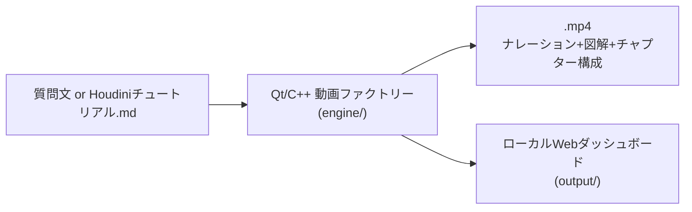
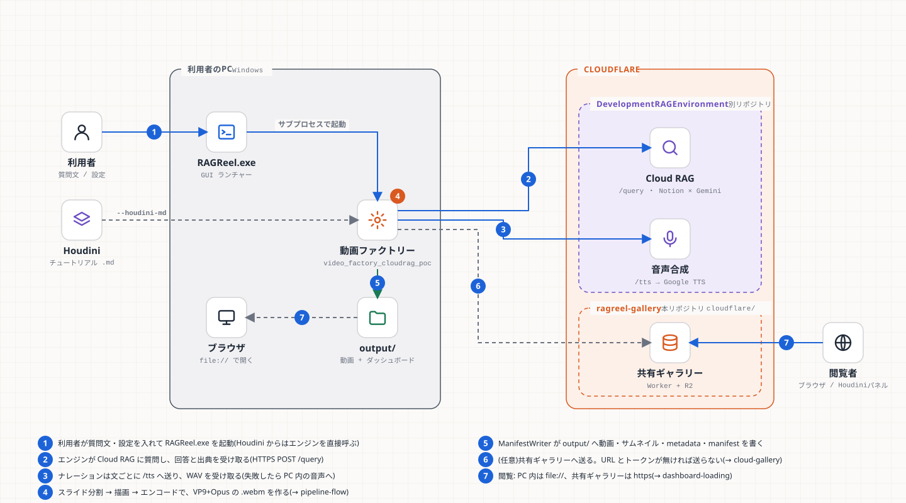

# RAGReel

Qtの学習兼各言語の比較を目的としたリポジトリです。

その学習の題材として、**RAG駆動チュートリアル動画生成ファクトリー**(Cloud RAGの知識をナレーション付き動画へ自動変換するQt/C++製ヘッドレスレンダリングエンジン)を実装しています。以下はこのファクトリーの概要・ビルド方法・動作確認手順です。

## これは何か

質問文字列(またはHoudiniで生成済みのチュートリアル`.md`)を渡すと、スライド形式・音声ナレーション付き・図解入りのチュートリアル動画(`.mp4`)を自動生成し、ローカルのWebダッシュボードに公開するツールです。





- **`video_factory_cloudrag_poc.exe`** — CLIバッチツール本体
- **`RAGReel.exe`** — 非エンジニア向けのGUIランチャー(上記exeをサブプロセスとして起動するだけの薄いラッパー)

詳しい仕組みは以下のドキュメントを参照してください。

| ドキュメント | 内容 |
|---|---|
| [docs/architecture/video-factory-design.md](docs/architecture/video-factory-design.md) | 初期アーキテクチャ設計(Phase 0)。§10に実装との乖離・追補あり |
| [docs/technical-reference.md](docs/technical-reference.md) | 実装済み内容の技術リファレンス(図解込み)。最新の実装状況はこちらが正 |
| [docs/learn/README.md](docs/learn/README.md) | **学習資料**(第1〜17章。言語・アルゴリズム・ビルドの基礎から、保守・拡張の手順、演習、トラブルシュートまで講義形式)。迷ったらここから |
| [docs/diagrams/](docs/diagrams/) | 構成図・フローチャート(SVG 6枚)。再生成は `python tools/build_diagrams.py` |
| [docs/ui-rules.md](docs/ui-rules.md) | Webダッシュボードの決めごと(アイコン・色の役割・動きの上限) |
| [docs/narration-quality.md](docs/narration-quality.md) | ナレーションの品質(読み・辞書・言い換え)の方針 |
| [lecture/video-factory-lecture.html](lecture/video-factory-lecture.html) | 開発の経緯を追う講義資料(ブラウザで開いて閲覧、外部ネットワーク不要) |
| [IMPROVEMENT_DESIGN_2026-10.md](IMPROVEMENT_DESIGN_2026-10.md) / [IMPROVEMENT_PLAN_2026-10.md](IMPROVEMENT_PLAN_2026-10.md) | 2026-10 の改善の設計と、実装状況・未確認事項 |
| [compare/README.md](compare/README.md) | 同じ入力を Qt / HyperFrames / Python の3方式で動画にした比較実装と実測(V1〜V7) |
| [IMPROVEMENT_PLAN.md](IMPROVEMENT_PLAN.md) | アーキテクチャ・リファクタリング計画と実施結果(Orchestrator/ScriptComposer/SceneAssembler/ServiceContainer抽出、CI導入) |

## 必要環境

- Windows 11 + Visual Studio 2022(MSVC)
- CMake 3.24+ / Ninja
- [vcpkg](https://github.com/microsoft/vcpkg)(manifestモード。`vcpkg.json`からQt6・FFmpeg・GTestを自動取得。既定では`C:/vcpkg`を想定 — 別の場所にある場合は`CMakePresets.json`の`default`プリセットの`CMAKE_TOOLCHAIN_FILE`を書き換えるか、`VCPKG_ROOT`環境変数を設定した上で`ci`プリセットを使う)
- `mermaid-cli`(`npm install -g @mermaid-js/mermaid-cli`。動画中のMermaid図解レンダリングに使用。無くてもビルド・`--mock`実行は可能で、図解はコードブロック表示にフォールバックする)

## ビルド

```powershell
cmake --preset default
cmake --build --preset default
```

初回はvcpkgがQt6/FFmpeg/GTestをソースからビルドするため、時間がかかります(環境によっては数十分)。

## 動作確認手順

### 1. 一番手軽な確認: CLIを`--mock`で動かす(APIキー不要)

```powershell
cd build\engine
.\video_factory_cloudrag_poc.exe "テストトピック" houdini21 --mock
```

- 実行が終わると同じフォルダの`output/`に動画とダッシュボードが生成されます。`output/index.html`をブラウザで直接開くか、`python -m http.server`等で配信して確認してください
- `--mock-plain`は見出しの無いプレーンな回答での動作確認用フィクスチャです
- Houdiniチュートリアルの取り込みモードも`--mock`と併用でき、ネットワーク接続なしに動作確認できます:
  ```powershell
  .\video_factory_cloudrag_poc.exe --houdini-md "<チュートリアル.mdへのパス>" --mock
  ```
  (同じ場所に同名の`.json`/`_screenshots.json`があれば自動的に使われます。無くても動きます)

### 2. GUIランチャー(RAGReel)を動かす

```powershell
cd build\engine
.\RAGReel.exe
```

起動すると「はじめに」タブが最初に表示されます。実際に動画を生成するには「設定」タブでCloud RAG URL・APIキーを入力してから「Cloud RAGクエリ」または「Houdiniチュートリアル」タブを使ってください(APIキーが無い場合はCLI側の`--mock`で確認するのが手早いです)。

### 3. 実際にCloud RAGへ接続して生成する(要APIキー)

```powershell
$env:CLOUD_RAG_URL = "https://rag-poc.xxxx.workers.dev"
$env:CLOUD_RAG_API_KEY = "..."

cd build\engine
.\video_factory_cloudrag_poc.exe "<質問文>" "<dbKey>"
```

### 4. 単体テストを動かす

```powershell
cd build
ctest --output-on-failure
```

`resource_budget_manager_test`(GPUリース排他制御)、`script_composer_tests`(スライド分割・Houdini解析)、`narration_tests`(読み・字幕・クラウド音声)、`manifest_writer_tests`(公開物の書き出し)、`cloud_rag_client_tests`(Cloud RAG クライアント)の5スイートが登録されています。どれもGPU/表示デバイス不要です。

Webダッシュボードと比較実装の検査(Node / Python のみ、ビルド不要):

```powershell
node tools/check_contrast.js
node tools/check_gallery_layout.js
cd compare; python -m unittest discover -s tests
```

### 書き出した動画の検査(`tools/verify_export.py`)

書き出した動画そのものを**測る**(「自分で作った動画を自分で採点しない」。QUALITY_UPLIFT QL5 / Z79)。ffmpeg / ffprobe と Pillow が要る。

```powershell
python tools/verify_export.py web/public/videos/<id>                       # 1 本(video.mp4 + metadata.json + 字幕)
python tools/verify_export.py out/video.mp4 --contact-sheet sheet.png      # コンタクトシート(拍ごとの前・拍・後)も書き出す
python tools/verify_export.py web/public/videos --all                      # ギャラリーの全部
python tools/verify_export.py a.mp4 --twin b.mp4                           # 同じ入力を 2 回書き出した 2 本が、同じフレームか
python -m unittest discover -s tools/tests -v                              # 検査自体の試験(悪い動画が、実際に不合格になる)
```

| 検査 | 内容 |
|---|---|
| `av-duration` | 映像と音声の長さ。エンジンが宣言した無音の余白(`kTailPaddingSeconds` = 1.5 秒)を許し、**音声が映像より長い**・**余白を超えて映像が続く**を不合格にする |
| `colors` | 目標色(エンジンが宣言した `#10140f`)との色差 ΔE。**開始・中間・終わり近く**で測り、途中の色のずれを捕まえる |
| `black-frames` / `audio-levels` | 途中の黒いフレーム・音割れ(ピーク 0 dBFS)・ほぼ無音 |
| `streams` | 映像・音声の有無、解像度、fps(旧版の 30fps は警告) |
| `subtitles` / `chapters` | 字幕・章(`metadata.json`)の時刻が、動画の長さと整合するか(無ければ skip) |
| `contact-sheet` | 拍ごと(章の開始。無ければ ffmpeg の場面検出)の「前・拍・後」の静止画。**合否は付けず、人が見る** |
| `--twin` | 決定性(同じ入力の 2 回の書き出しで、フレームが同じか) |

基準は `tools/video_spec.json`(エンジンの宣言した値。出どころをコメントに書いてある)。終了コード: 0 = 不合格なし / 1 = 不合格あり。**書き出しのたびに自動では走らない**(エンジンの C++ には組み込んでいない)。

**ギャラリーの古い書き出し(7 月・SAPI)が長さの検査で不合格になるのは、エンジンの不具合のため**: SAPI の WAV は `data` の後ろに `EVNT` チャンクを持ち、エンジンはそれまで音声の長さに数えて、ナレーションを約 0.7% 長く報告していた(映像が 0.8〜4 秒長く、字幕も後ろほど遅れる)。**2026-11-11 に修正**(`wav_util::pcmDurationSeconds`。実機の SAPI で、報告値と実際の長さが一致することを確認)。**直った後の書き出しは、この検査を通る**。古い動画は、書き出し直すと直る。

## リポジトリ構成(概略)

```
engine/
├── src/
│   ├── main_cloudrag.cpp     # 動画生成エンジンのエントリポイント
│   ├── main_launcher.cpp     # RAGReel(GUI)のエントリポイント
│   ├── orchestrator/         # GPUリース排他制御・ステージ記録
│   ├── ingest/                # スライド分割・Houdini解析(ScriptComposer)
│   ├── scene/                 # ヘッドレスQMLレンダリング(SceneAssembler)
│   ├── services/               # DI(NarrationEngine/CloudRagClient/VideoEncoder/ManifestWriter)
│   ├── encode/ narration/ ragclient/ manifest/ launcher/ common/
│   └── ...
├── qml/                        # QMLシーン・RAGReel UI
└── tests/                      # 単体テスト(GTest / フレームワーク不使用)
web/public/                      # 静的Webダッシュボード(ランディング・ギャラリー・詳細・比較。比較は開発者向けで、公開側では既定でリンクを出さない: `?dev=1` で一度開くと出る・`?dev=0` で戻る・localhost では常に出る)
cloudflare/ragreel-gallery/      # 共有ギャラリー(Worker + R2。任意)
compare/                         # Qt / HyperFrames / Python の3方式比較(Python + テスト)
tools/                           # 検査・図の生成(check_*.js / build_diagrams.py)
installer/                       # Inno Setup のインストーラー
docs/                            # 設計書・技術リファレンス・学習資料(learn/)・図(diagrams/)
lecture/                         # 開発の経緯の講義資料(HTML)
```

詳細は[docs/technical-reference.md §13](docs/technical-reference.md#13-ファイル構成)を参照してください。
