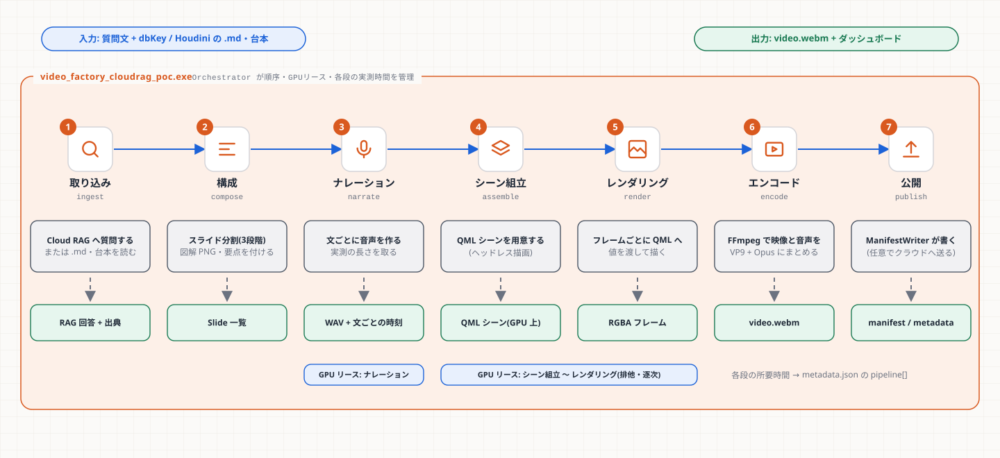

# 第4章 エンジンの構造

**学習目標**: ① 7段のパイプラインを順に言える ② Orchestrator・GPUリース・サービスコンテナ(DI)が何のためにあるか説明できる ③ 「新しい処理をどこに置くか」を判断できる

## 4.1 7段のパイプライン



段の名前は `engine/src/orchestrator/job_pipeline.h` の `enum class JobStage` にある。

| # | JobStage | キー | 主なコード | 成果物 |
|---|---|---|---|---|
| 1 | Ingest | `ingest` | `ragclient/cloud_rag_client.cpp`・`ingest/houdini_script.cpp` | RAG 回答 + 出典 |
| 2 | Compose | `compose` | `ingest/script_composer.cpp` | `std::vector<Slide>` |
| 3 | Narrate | `narrate` | `narration/*` | WAV + 時刻 |
| 4 | Assemble | `assemble` | `scene/scene_assembler.cpp` | QML シーン(準備) |
| 5 | Render | `render` | 同上 + `qml/CloudRagScene.qml` | RGBA フレーム |
| 6 | Encode | `encode` | `encode/video_encoder.cpp` | `.webm` |
| 7 | Publish | `publish` | `manifest/manifest_writer.cpp` | `output/` 一式 |

これらを順に呼ぶ本体は `engine/src/main_cloudrag.cpp`(長い1つの `main`)。各段のあとで `orchestrator.recordStage(JobStage::X, 成功か, 秒数)` を呼ぶ。この記録が `metadata.json` の `pipeline[]` になり、ダッシュボードの「生成過程」(ステップ表示)になる。

## 4.2 Orchestrator と GPU リース

```cpp
GpuLease lease = orchestrator.acquireGpuLease(GpuLeaseOwner::NarrationEngine);
// ... この間だけ GPU を使ってよい ...
// lease が破棄されると自動で返却される(RAII)
```

- **なぜ要るか**: ナレーション(音声合成)とシーン描画が同時に GPU/VRAM を使うと、メモリが足りなくなる。そこで「**同時に持てるのは1つだけ**」の札(`GpuLease`)を `ResourceBudgetManager`(mutex + condition_variable)が貸し出す。
- **RAII**: 札はオブジェクトで、スコープを抜けると自動で返る。返し忘れが起きない。
- **ナレーション → シーン組立〜レンダリング**の順に、排他で逐次(同時並行にしない)。
- テストは `engine/tests/resource_budget_manager_test.cpp`(2つの所有者が同時に取れないこと)。

> 学び: 並行に速くするより、**厳密な逐次**にして VRAM の競合を無くすほうが、このシステムでは安定する(設計書 §3)。

## 4.3 サービスコンテナ(DI)

`engine/src/services/interfaces.h` に 4 つの**インターフェース**がある。

| インターフェース | 実物 | 目的 |
|---|---|---|
| `INarrationEngine` | `NarrationEngine`(SAPI)/ VOICEVOX / クラウド | 音声を作る |
| `IVectorStoreClient` | `CloudRagClient` | 質問に答えさせる |
| `IVideoEncoderFactory` | `VideoEncoder` | 動画ファイルを書く |
| `IManifestWriter` | `ManifestWriter` | 公開する |

- **DI(依存性注入)**: 呼ぶ側(`main`)は実物のクラスでなく**インターフェース**に依存する。テストでは偽物(ネットワーク不要・音声不要)に差し替えられる。
- `IVideoEncoder` だけは、**1つを作って登録する形ではなく「工場(Factory)」を登録**する。エンコーダのコンストラクタが、出力先・解像度・音声パスという、**動画ごとに決まる値**を要求するため。

## 4.4 ファイルの置き場(どこに何を足すか)

```
engine/src/
├── main_cloudrag.cpp     # 7段を順に呼ぶ(エントリ)
├── main_launcher.cpp     # GUI(RAGReel.exe)のエントリ
├── orchestrator/         # 段の型・GPUリース・実測記録
├── ragclient/            # Cloud RAG への HTTP
├── ingest/               # スライド分割・Houdini 取り込み
├── narration/            # 音声(3種)・辞書・字幕
├── scene/                # ヘッドレス QML 描画
├── encode/               # FFmpeg
├── manifest/             # 公開(ローカル + クラウド送信)
├── launcher/             # GUI 側の部品(設定・履歴・キュー・子プロセス)
├── services/             # DI のインターフェース
└── common/               # 小さな共通関数
```

**判断の指針**
- 新しい「外部サービスに聞く」処理 → `ragclient/` か新ディレクトリ + インターフェース(`services/`)
- 新しい「声」 → `narration/`(第6章・第12章)
- 動画の見た目 → `qml/CloudRagScene.qml`(第7章)
- 公開物の項目 → `manifest/` + `web/public/`(両方。契約なので同時に)
- GUI の設定項目 → `launcher/launcher_settings.*` + `qml/SettingsTab.qml`

## 4.5 設計の流れ(歴史を知ると意図が分かる)

1. Phase 1〜2: 静的シーン → FFmpeg の最小実装、Cloud RAG 連携
2. Phase 2.5〜2.6: 音声・スライド形式・図解・分割画面
3. Phase 8(2026-08-14): `main` が肥大化したため、Orchestrator / ScriptComposer / SceneAssembler / ServiceContainer に**切り出し**、CI を追加(`IMPROVEMENT_PLAN.md`)
4. 2026-10: 字幕・クラウド音声・共有ギャラリー・ダッシュボード刷新・比較実装

> 学び: **まず動かし、肥大化したら責務ごとに切り出す**。最初から完璧な構造を目指さない。ただし切り出すときは、公開 API を変えずに(テストで守って)行う。

## 演習

1. `Narrate` の次に `Assemble` が来る。順序を入れ替えると何が困るか。
2. `IVideoEncoder` をそのまま1つ登録せず、Factory にした理由を述べよ。
3. 「メール通知を送る段」を足すなら、`JobStage` のどこに足し、何を変えるか。

## 解答(例)

1. 描画は音声の長さ(尺)に依存するので、先にナレーションで尺が決まらないとフレーム数が決められない。
2. 出力先・解像度・fps・音声パスは動画ごとに決まり、音声パスはナレーション後にしか分からない。起動時に1つ作って登録できない。
3. `job_pipeline.h` の `JobStage`(と `jobStageLabel` / `jobStageKey`)に足し、`main_cloudrag.cpp` で呼んで `recordStage`。`metadata.json` の `pipeline[]` が増えるので、ダッシュボードのステップ表示が増えた段を表示できるか(`app.js` の `stepsHTML`)も確認する。
