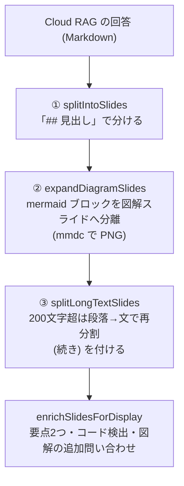

# 第5章 入力と構成(Ingest / Compose)

**学習目標**: ① Cloud RAG への問い合わせの形を説明できる ② スライド分割の3段階と、その理由を言える ③ 各スライドの時間配分の考え方を説明できる ④ Houdini 取り込みの要点を知る

## 5.1 Cloud RAG に聞く(`ragclient/cloud_rag_client.*`)

```cpp
auto client = CloudRagClient::fromEnvironment();      // CLOUD_RAG_URL / CLOUD_RAG_API_KEY
CloudRagResponse r = client->query("質問", "houdini21");
// r.answer (Markdown) / r.sources[{title, db, score}] / r.extractionRate ...
```

- 通信は `POST {URL}/query` と `POST {URL}/me/namespaces`(使える知識ベースの一覧)。`Authorization: Bearer`。
- `answer` は **Markdown**。見出し(`##`)・コードブロック・Mermaid 図の記法を含みうる。
- エラー(`quota_exceeded`・`rate_limited`)は、利用者に分かる専用のメッセージにする。
- **旧構成の名残**: ドキュメントに「GAS」とある箇所は、Google Apps Script だった旧構成の記述。現行は Cloudflare Worker(コードが正)。

## 5.2 スライド分割は3段階(`ingest/script_composer.cpp`)



**なぜ3段階か**: 実際の回答は(a) 見出しが無いことがある (b) 1節が長すぎることがある。①だけだと、見出しなしの回答が「1枚の長いスクロール動画」になる不具合が実際に起きた。③の追加で、**見出しの有無に関わらず必ずスライド形式になる**ことを保証した。

- `Slide`(`script_composer.h`)の主な項目: `heading`・`body`(元の文章。読み上げ用)・`bullet1/2`(画面に出す要点)・`diagramImagePath`(図)・`codeBlock`(コード)・`narration`・`visualKind`(Node / Viewport / Other)。
- **画面に出すのは要点2つだけ**。本文は読み上げ(ナレーション)専用。長い文章を画面に流さない。
- 図解は `enrichSlidesForDisplay` が、スライドごとに Cloud RAG へ「この内容の Mermaid 図を」と追加で聞き、`mmdc`(mermaid-cli)で PNG にする。**ベストエフォート**で、失敗してもそのスライドを図なしで続ける(1枚の失敗で動画全体を止めない)。`--mock` では聞かない。

## 5.3 ナレーション文を作る

- `stripMarkdownForNarration`: Markdown 記号・出典番号(`[1]` など)・コードの中身を、読み上げに適した文章に変える。コードブロックは、そのまま読まず、Cloud RAG から別に取った**音声用の説明文**(`codeCaptions`)に置き換える(取れなかった分は定型の一言)。
- `stripCitationMarkers`: `[1]` や `[参考: 過去Q&A]` のような出典の印を除く。Mermaid の生成依頼に混ざると「`[...]` = 四角のノード」と解釈されて、図に余計なノードが出る不具合が実際に起きた。コードブロックの中(`array[0]` など)には適用しない。
- 発音の辞書(`narration/pronunciation.*`、`assets/tts_dictionary.json`)で、英語名・略語の読みを直す(第6章)。

## 5.4 時間配分(`computeSlideStartFrames`)

動画の尺は**音声の長さ(実測)+ 余韻**で決まる。その尺を、各スライドへ配る。

- **基本**: 各スライドの本文の文字数に比例して配分(最低文字数の下限あり)。
- **Houdini 動画**: 画面の種類ごとの目標比率 = **ノード画面 7 : ビューポート 2 : その他 1**(`kNodeTimeShare` などの定数)。種類が存在しない分は他へ比例配分。**どのスライドも 2.5 秒未満にしない**。
- 戻り値は「各スライドの開始フレーム番号の配列」。描画ループは、今のフレームがどのスライドかを調べて、QML に `slideHeading`・`slideProgress` などを渡す(第7章)。

> 学び: 時間配分のような**純粋な計算は、引数と戻り値だけの関数**にしてある。だから GUI も GPU も無しで単体テストできる(`script_composer_test.cpp`)。

## 5.5 Houdini 取り込み(`ingest/houdini_script.*` など)

Houdini 側が出す手順書とスクリーンショットから動画を作る。

| 入力 | 内容 |
|---|---|
| `--houdini-md` | チュートリアルの Markdown |
| `--houdini-json` | ノードグラフ |
| `--houdini-screenshots` | 手順ごとの画像の一覧(ビューポート / ネットワーク / パラメータカード) |
| `--houdini-script` | 初心者向けの台本(JSON。手順ごとの音声に使う) |

- **画像の選び方**: 各手順で、ビューポートとネットワーク図のどちらを見せるかを決める(`buildHoudiniStepSlidesFromScreenshots`)。`cook_node` とビューポート画像しか無い手順は常にビューポート。それ以外は、前の手順から画像が変わった手順を、全体の約 2/9 まで均等に散らしてビューポートにする。
- **重要な発見**: ノード構成のセクション(`## コード・ノード構成`)を、生のコードのまま通すと、**コードが読み上げられて動画が異常に長くなる**。要約(`summarizeHoudiniNodeGraph`)で置き換える(`replaceNodeConfigSection`)。
- **画像の無いスライド**: 説明スライドには、ノードの関係図か完成画像を入れる(`assignPlaceholderImages`)。右側が空の板になるのを防ぐ。

## 演習

1. 見出しが無い 1,000 文字の回答は、どの段階で何枚になるか。
2. 図解の追加問い合わせが失敗したとき、動画はどうなるか。
3. Houdini 動画で、ビューポートの尺が一部の手順に偏る問題を、どう避けているか。

## 解答(例)

1. ①で1枚(見出し無しなので全体で1枚)→ ③で 200 文字ごとの段落/文で再分割され、およそ5枚以上。2枚目以降の見出しには「(続き)」が付く。
2. 例外を握ってそのスライドの図を諦め、(`bullet` と本文だけで)続ける。動画全体は失敗しない。
3. ビューポートの手順を、全体に均等に散らして(約 2/9)選ぶ。cook_node の少数手順だけに 2 割が集中して、1 枚が極端に長く固定されるのを避ける。
