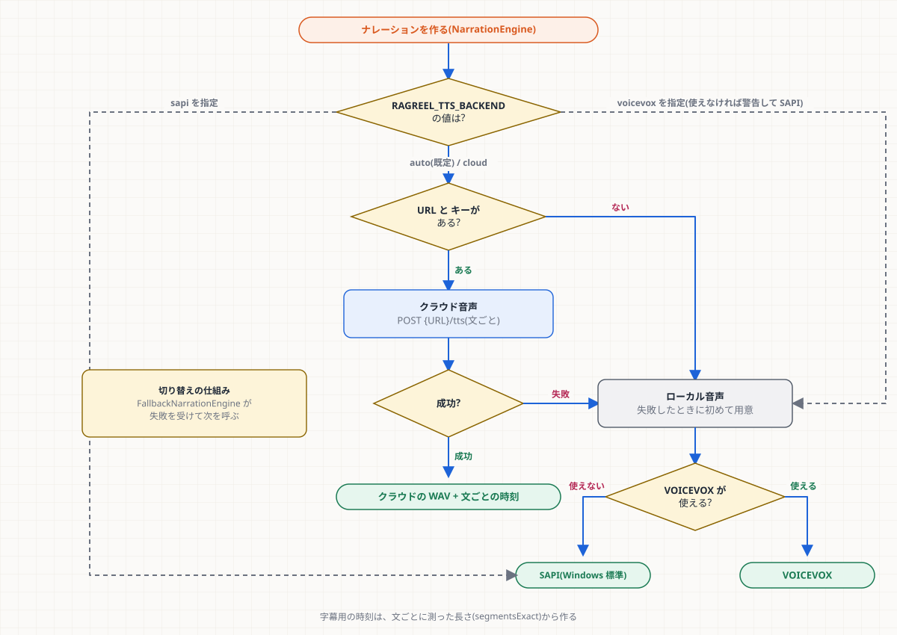
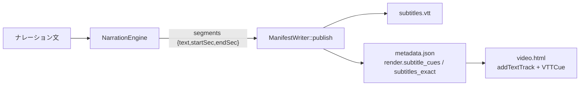

# 第6章 ナレーション(音声・読み・字幕)

**学習目標**: ① 3種の音声(クラウド・VOICEVOX・SAPI)の選び方を図なしで説明できる ② 発音辞書の役割と限界を言える ③ 文ごとの時刻から字幕が作られる流れを追える

## 6.1 3種類の声

| 声 | 品質 | 前提 | 時刻 | コード |
|---|---|---|---|---|
| **クラウド音声** | 高い(Google Cloud TTS。例: `ja-JP-Chirp3-HD-Aoede`) | `CLOUD_RAG_URL` + キー(ネットが要る) | 文ごとの**実測** | `narration/cloud_tts_engine.*` |
| **VOICEVOX** | 高い(自然な声) | VOICEVOX ENGINE を PC に導入 | 文ごとの**実測** | `narration/voicevox_narration_engine.*` |
| **SAPI5** | 低め(Windows 標準) | 何も要らない | 全体の長さを文字数で配分した**概算** | `narration/narration_engine.*` |

**共通の入口**は `INarrationEngine::synthesize(text, wavPath)`。戻り値 `NarrationResult` は、WAV のパス・長さ・エンジン名・**文ごとの区間**(`segments`: 文・開始秒・終了秒)・時刻が正確かの印(`segmentsExact`)。

## 6.2 どれを使うか(選び方)



選択は `services/concrete_services.h` の `makeNarrationEngineFromEnvironment()`。

- 既定の `auto`: クラウドの URL とキーがあれば**クラウド音声**。**失敗したら**ローカル(VOICEVOX が使えれば VOICEVOX、なければ SAPI)へ切り替える。
- **ローカル音声は、失敗するまで作らない**(`LazyNarrationEngine`)。VOICEVOX の探索・起動は最大 90 秒かかりうるので、普段は払わない。
- `FallbackNarrationEngine`: 「1つ目を試して、例外が出たら2つ目」を包むクラス。切り替えたことはログに残る(黙って品質が落ちるのを防ぐ)。
- `voicevox` 指定でも VOICEVOX が応答しなければ、警告を出して SAPI に落ちる。
- **選んだ声と理由は、ログの1行に出る**(`note`)。動画の声がおかしいときは、まずこのログを見る。

## 6.3 クラウド音声の処理(`cloud_tts_engine.cpp`)

1. `pronunciation::prepareForSapi` で辞書・略語を直す
2. 文ごとに分割(1回 200 文字まで)
3. 1 文ずつ `POST {URL}/tts` → 24 kHz の WAV
4. 44.1 kHz に変換して連結。文の間は 0.25 秒の無音
5. 各文の開始・終了を、連結したサンプル数から求める → `segmentsExact = true`

**失敗の扱い**: HTTP の状態と Worker のエラー文(例: 1日の上限)を**例外の文に含める**。通信できないときはタイムアウトで例外。呼ぶ側(Fallback)が受けてローカルへ。
**User-Agent を明示する**(`RAGReel/1.0 (cloud-tts)`): ライブラリの既定の UA は Cloudflare に弾かれることがある。

## 6.4 発音辞書(`pronunciation.*`、`assets/tts_dictionary.json`)

日本語の声は、英語の用語(`Houdini`・`Attribute Wrangle`・`VEX`)を、1文字ずつ読んだり崩れたカタカナで読んだりする。そこで、**読み上げる直前**にだけ文字列を置き換える。

```json
{ "surface": "Houdini", "pronunciation": "フーディニ", "accent_type": 0 }
```

- 置換は**長い語が先**(`Attribute Wrangle` が `Wrangle` より優先)。英字は大文字小文字を区別せず、**単語単位**(`VEX` は `VEXpression` の中に当たらない)。
- 辞書に無い大文字の略語(2〜6字)は、1字ずつ読む(`ABC` → エービーシー)。
- **字幕は元の綴りのまま**(置換するのは読み上げる文だけ)。
- 辞書は VOICEVOX ではユーザー辞書として登録、SAPI/クラウドでは文字列置換で使う。

> 足すとき: `tts_dictionary.json` に1件足して、`pronunciation_test.cpp` に1ケース足す(第12章 レシピ3)。

## 6.5 字幕(`subtitle_writer.*`)



- `wrapLines`: 日本語を 22 文字 × 2 行に折る。「、」「。」の直後を優先する。**文字を落とさない**。
- `toSrt` / `toVtt`: 時刻が不正・空の文を除き、番号は書いた分だけ振り直す。
- **時刻が概算(SAPI)の場合は `subtitles_exact: false`** を記録する。画面は「ずれうる」ことを分かるようにできる。
- 字幕が無い(旧動画・無音)なら、何も書かず、ダッシュボードも何も出さない。

> **未確認**: VOICEVOX 経路で実際に合成した時刻(開発 PC に VOICEVOX が無いため、実機での突き合わせはしていない)。

## 6.6 品質の方針

`docs/narration-quality.md` に、読み・言い換え・長さの方針がある。声の自然さを上げるには、まず**クラウドかVOICEVOX**を使う(SAPI は最終手段)。

## 演習

1. クラウドの URL とキーを設定したが、通信できない環境で動画を作る。何の声になり、どこで分かるか。
2. 字幕の文が「Houdini」のままなのに、音声は「フーディニ」と読まれる。バグか。
3. 新しいクラウド声に変えたい。コードを変えずにできるか。

## 解答(例)

1. クラウド音声が例外 → ローカル。VOICEVOX が使えれば VOICEVOX、無ければ SAPI。ログの「声の選択」の行と、切り替え時の警告で分かる。
2. 仕様どおり(字幕は元の綴り、読み上げだけ置換)。
3. できる。`RAGREEL_CLOUD_TTS_VOICE`(例 `ja-JP-Chirp3-HD-Aoede`)と `RAGREEL_CLOUD_TTS_RATE`(0.8〜1.3)で変えられる。
