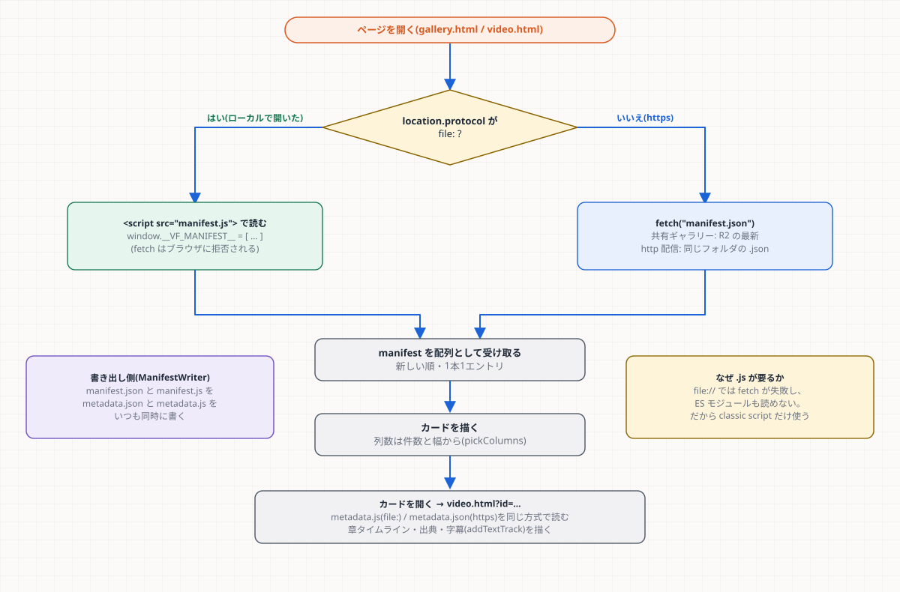

# 第8章 公開とダッシュボード

**学習目標**: ① 公開時に書かれるファイルと、その形(契約)を説明できる ② `file://` で動かすための制約と回避策を言える ③ `app.js` の構造と UI ルールを理解し、画面を安全に変更できる

## 8.1 公開(Publish)で何が書かれるか

`ManifestWriter::publish()` が、動画の生成後に自動で行う(手でコピーしない)。

```
output/
├── index.html gallery.html video.html random.html   ← 画面(ビルド時に配置)
├── styles.css app.js hero-disc.js
├── manifest.json   manifest.js          ← 一覧(新しい順)
└── videos/<id>/
    ├── video.webm          ← 動画
    ├── thumb.png           ← サムネイル
    ├── metadata.json  metadata.js   ← 詳細
    └── subtitles.vtt       ← 字幕(あれば)
```

手順: ① `videos/<id>/` を作る → ② 動画をコピー → ③ サムネイル保存 → ④ `metadata.json`/`.js` → ⑤ `manifest.json` を**読み込み、既存を保ったまま先頭に追加**して書き戻す(同じ id は置換)→ ⑥(任意)共有ギャラリーへ送る(第9章)。

- **`compare.html`(と比較用の動画)・`404.html` はローカルの `output/` に置かない**。比較ページは共有ギャラリー(Worker のデプロイ)だけにあり、ローカルでは「方式の比較」のリンクもキー操作 `C` も出さない(`HAS_COMPARE`)。
- **初回(まだ動画が無い)は `manifest.js` が無い**。`loadManifest` は、これを空の一覧として扱い、空状態(回転寿司ベルト)を出す。
- **画面の部品は、ビルド時に `output/` へ置かれる**(`engine/CMakeLists.txt` の `_dashboard_file` の一覧)。新しいページ/JS/CSS を足したら、この一覧と `installer/ragreel.iss` にも足す(足し忘れで「配布版にだけ無い」になる)。

## 8.2 データの形(契約)



`manifest.json`(一覧の1件):

```jsonc
{ "id": "cloudrag_20260714_192246", "title": "…", "created_at": "ISO8601",
  "duration_sec": 84.4, "video_path": "videos/<id>/video.webm", "thumbnail_path": "videos/<id>/thumb.png",
  "tags": ["houdini21","cloud-rag"], "status": "done", "estimated_tokens": 522, "chapter_count": 8 }
```

`videos/<id>/metadata.json`(詳細):

```jsonc
{ "narration_summary": "…",
  "rag_sources": [{ "file": "…", "namespace": "…", "similarity": 0.0 }],
  "render": { "width": 1280, "height": 720, "fps": 15, "file_size_bytes": 0,
              "subtitles": "subtitles.vtt", "subtitles_exact": true, "subtitle_cues": [ … ] },
  "chapters": [{ "title": "…", "kind": "node", "start_sec": 0.0, "duration_sec": 0.0 }],
  "pipeline": [{ "stage": "ingest", "label": "取り込み", "status": "done", "duration_sec": 0.0 }] }
```

**契約のルール**
1. **C++(`manifest_writer.cpp`)と JavaScript(`app.js` ほか)の両方が、この形に依存する**。片方だけ変えない。
2. **項目は足す。変えない・消さない**。旧い動画(古い `metadata.json`)は項目が無いので、**JavaScript 側は「無ければ省略」**で書く(`chapters` が無い動画では章タイムラインだけを出さない、など)。
3. 値が分からないときは **0 や空を書かず、項目ごと出さない**(「0秒」「0×0」の誤表示を防ぐ。テストで守っている)。

## 8.3 `file://` の制約(最重要)

ダッシュボードは、アプリの「ダッシュボードを開く」で **`file://`(ファイルを直接開く)**で表示される。ブラウザは、この状態での次を**拒否**する。

- `fetch("manifest.json")`(ローカルファイルの読み込み)
- ES モジュール(`<script type="module">`、`import`)

回避策(このプロジェクトの決まり):
- `ManifestWriter` が `manifest.json` と**同じ内容の `manifest.js`**(`window.__VF_MANIFEST__ = [...]`)も書く。`metadata.js` も同様。
- `app.js` は `IS_LOCAL_FILE = location.protocol === "file:"` のときだけ `<script>` タグで読み、https(共有ギャラリー)では普通に `fetch()` する(`loadManifest` / `loadVideoMetadata`)。
- JavaScript は **classic script だけ**(モジュール不使用)。three.js も `r128` の classic ビルドを使う(`hero-disc.js`)。
- 字幕は `<track src>` が読めないので、cue を `metadata` に埋めて `addTextTrack` + `VTTCue` で付ける。

> 学び: **「動く環境の制約」を最初に確認**してから作る。モジュールで作り直す羽目になる前に。

## 8.4 `app.js` の構造

全ページが共有する部品(約 1,000 行)。ページ固有の処理は各 HTML の中。

| まとまり | 主な関数 | 用途 |
|---|---|---|
| 読み込み | `loadManifest` `loadVideoMetadata` `loadScript` | file:// と https の切り替え |
| 安全 | `escapeHTML` | **`innerHTML` に入れる文字列は必ず通す**(共有ギャラリーでは他の人のタイトルが入りうる) |
| 書式 | `formatDuration` `formatDateShort` `formatBytes` `formatTokens` | `m:ss`、`YYYY/M/D` など(UIルール) |
| アイコン | `ICONS` `icon()` | 線画SVG 1セット(足すときは同じ線幅で `ICONS` に) |
| テーマ | `toggleTheme` `currentTheme` | ライト/ダーク(`localStorage` の `vf_theme`) |
| 部品 | `showToast` `openModal` `countUp` | 通知・確認・数のカウントアップ |
| 共有ギャラリー | `deleteVideoRemote` | 削除(トークン入力 → DELETE) |
| ギャラリー | `pickColumns` `thumbHTML` `tagsHTML` `createPreviewManager` | 列数・カード・ホバー再生 |
| 詳細 | `chapterTimelineHTML` `wireChapterTimeline` `stepsHTML` `sourcesHTML` | 章タイムライン・生成過程・出典 |
| 操作 | `SHORTCUTS` `initShortcuts` `showShortcutHelp` | キー操作 |
| 空状態 | `startSushiBelt` | 回転寿司ベルト |
| 閲覧 | `initStackBrowser` | スワイプで1枚ずつ見る |

## 8.5 UI ルール(`docs/ui-rules.md` の要点)

| 項目 | 決め |
|---|---|
| 色の役割 | **オレンジ=主操作 / ミント=完了 / 青=情報 / 黄=注意 / ピンク=エラー・削除 / 紫=RAG出典**。役割以外に使わない |
| アイコン | `ICONS` の線画 1 セットだけ。**絵文字は使わない** |
| 数字 | `font-variant-numeric: tabular-nums`。`m:ss`、`YYYY/M/D` |
| 動き | **1画面で2種類まで**。すべて `prefers-reduced-motion` で止める |
| 破壊的操作 | 画面の端に分け、**モーダルで確認** |
| ダーク | 暖かい炭色の地。文字色は**コントラスト 4.5:1 以上** |

> 「表に無いものを足すときは、先に表へ書く」。見た目のバラつきは、決めていないことから生まれる。

## 8.6 画面を変更するときの手順

1. 変更が**契約**(manifest/metadata)に触れるか確認する(触れるなら C++ とテストも)。
2. HTML/JS/CSS を変える。`innerHTML` には `escapeHTML` を。
3. `node tools/check_contrast.js`(色を足したら)、`node tools/check_gallery_layout.js`(列数に触れたら)。
4. **ブラウザで実際に開く**(`file://` と、可能なら https の両方)。`file://` でだけ壊れる変更が多い。
5. 空ギャラリー・旧い動画(項目が無い)・ダーク・「動きを減らす」でも見る。

## 演習

1. `metadata.json` に `language` という項目を足したい。どこを変え、旧い動画はどうなるか。
2. 画面に ES モジュールの新しいライブラリを入れたい。何が問題で、どうするか。
3. 動画のタイトルに `` と入っていた。`innerHTML` に入れると何が起きるか。

## 解答(例)

1. `ManifestVideoDetail` と `manifest_writer.cpp`(書き出し)、`manifest_writer_test.cpp`(項目あり/無しのテスト)、表示する JS。旧い動画は項目が無いので、JS は「無ければ表示しない」と書く。
2. `file://` で ES モジュールがブロックされる。classic ビルド(UMD)の版を選ぶ、またはその機能を自前で書く。CDN に届かないときの代替(フォールバック)も用意する。
3. スクリプトが実行されうる(XSS)。必ず `escapeHTML` を通す。共有ギャラリーでは他人のタイトルが入りうるので特に重要。
