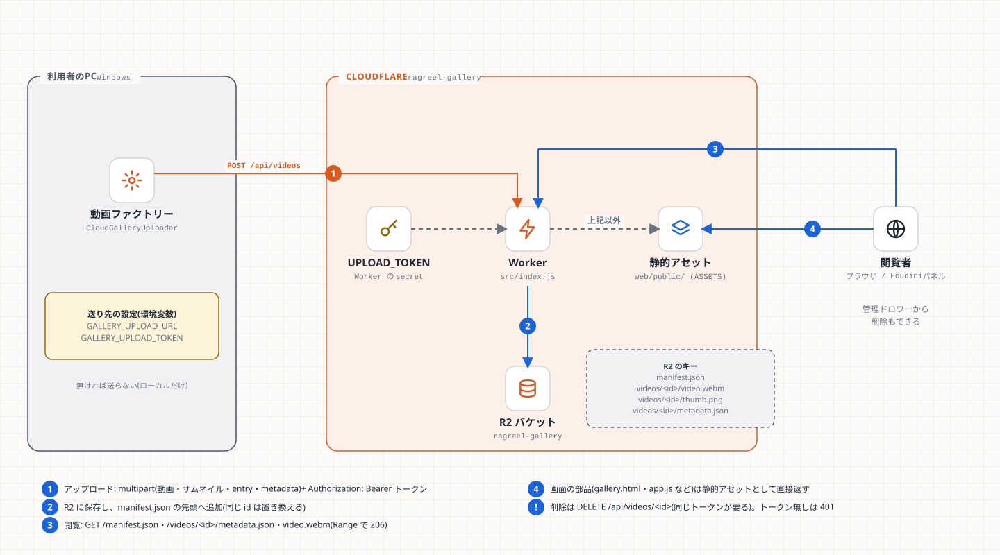

# 第9章 共有ギャラリー(Cloudflare Worker + R2)

**学習目標**: ① なぜ共有ギャラリーがあり、何を置き換えないかを説明できる ② Worker のルートと認証を説明できる ③ HTTP Range が何のためにあるか言える ④ デプロイと確認の手順を実行できる

## 9.1 目的

PC 内の `output/` は、その PC でしか見られない。共有ギャラリーは、同じデータの形(第8章)をクラウドにも置き、**URL で共有・バックアップ**できるようにする。Houdini の内蔵ブラウザのタブで開く用途もある。

**置き換えではなく、任意のミラー**。ローカルの公開は常に先に成功し、クラウドへの送信が失敗しても動画は失われない。



## 9.2 部品

| 部品 | 場所 | 役割 |
|---|---|---|
| **Worker** | `cloudflare/ragreel-gallery/src/index.js` | API と、動画・メタデータの配信 |
| **R2 バケット** | Cloudflare(`ragreel-gallery`) | `manifest.json`、`videos/<id>/video.webm` `thumb.png` `metadata.json` |
| **静的アセット** | `web/public/`(`wrangler.jsonc` の `assets`) | 画面そのもの(`gallery.html` など) |
| **アップローダー** | `engine/src/manifest/cloud_gallery_uploader.*` | エンジンから POST |
| **secret** `UPLOAD_TOKEN` | Worker の環境 | 書き込みの合言葉 |

## 9.3 ルートと認証

| メソッド・パス | 認証 | 内容 |
|---|---|---|
| `POST /api/videos` | **要** | 動画一式を保存し、manifest の先頭に追加 |
| `DELETE /api/videos/:id` | **要** | 3ファイルを消し、manifest から外す |
| `GET /manifest.json` | 不要 | 最新の一覧(`no-store`) |
| `GET /videos/:id/metadata.json` `video.webm` `thumb.png` | 不要 | R2 から配信。動画は Range 対応 |
| それ以外 | 不要 | 静的アセット |

```js
function isAuthorized(request, env) {
  if (!env.UPLOAD_TOKEN) return false;                 // 未設定なら書き込みは全部拒否
  return (request.headers.get("authorization") || "") === `Bearer ${env.UPLOAD_TOKEN}`;
}
```

- **公開 = 誰でも読める**。**書き込みだけ**トークンで守る。トークン無しの `DELETE` は 401。
- `isValidId`: id に `/` と `..` を含めない(別の場所のファイルを指定するパス・トラバーサルの防止)。
- **ダッシュボードの管理ドロワー**から削除するときは、利用者がトークンを入力する(`deleteVideoRemote`)。トークンは画面にもリポジトリにも置かない。

### `run_worker_first` とは
静的アセットは、通常は Worker を通らず直接返る。ところが `/manifest.json` や `/videos/*/video.webm` は**動的に R2 から返したい**。`wrangler.jsonc` の `run_worker_first` に列挙したパスだけ、先に Worker が受ける。**ルートを足したら、ここにも足す**(足し忘れると、静的アセットの404になる)。

## 9.4 HTTP Range(動画のシーク)

`<video>` は、再生位置を飛ばす(シーク)とき、`Range: bytes=1000000-` のように**ファイルの途中だけ**を要求する。サーバーが対応していなければ、ブラウザは**全体を読み込んでから**でないと飛べない。章タイムラインのクリック(該当時刻へ移動)が、これに依存する。

```
要求: GET /videos/x/video.webm      Range: bytes=500-999
応答: 206 Partial Content           Content-Range: bytes 500-999/123456   Accept-Ranges: bytes
```

実装は `serveVideoObject`: R2 の `get(key, { range: request.headers })` に Range を渡し、返ってきた範囲から `Content-Range` を組み立てて 206 で返す。`bytes=a-b` / `a-` / `-n`(末尾から n バイト)の3形を、ローカルの `wrangler dev` で確認済み。

> **未対応の場所**: `web/public/compare/*.webm` など、**静的アセットとして置いた動画**は Worker を通らず、Range に 206 を返さない(200 で全体)。章ジャンプが要るのは `/videos/...`(R2)だけなので、問題にしていない。

## 9.5 エンジンからの送信(`cloud_gallery_uploader.cpp`)

- `GALLERY_UPLOAD_URL` と `GALLERY_UPLOAD_TOKEN` が**両方**あるときだけ送る。無ければ何もしない(従来どおりローカルのみ)。
- `QHttpMultiPart` で、`id`・`entry`(manifest の1件)・`metadata`・`video`・`thumbnail` を送る。
- **HTTP/2 を無効**にする(`Http2AllowedAttribute = false`)。Qt の multipart と Cloudflare の HTTP/2 の組み合わせで、エラーになったため。
- 失敗は**例外にするが、呼ぶ側(`ManifestWriter::publish`)が握って警告のみ**。ローカルの公開が成功した後に呼ぶので、ネットの不調で動画が失われない。

## 9.6 デプロイ

```powershell
cd cloudflare\ragreel-gallery
npx wrangler deploy
```

| 注意 | 理由 |
|---|---|
| `compatibility_date` は**未来の日付にしない**(現在 `2025-01-01`) | 未来だと拒否される |
| `UPLOAD_TOKEN` は `npx wrangler secret put UPLOAD_TOKEN` で設定。コマンドや設定ファイルに値を書かない | 公開リポジトリ。履歴に残る |
| `.wrangler/` は追跡しない(`.gitignore`) | アカウント情報が入る |
| 静的アセットは `web/public/` が丸ごと上がる。`.assetsignore` で除外を決める | 動画や巨大ファイルを上げたくない |

**デプロイ後の確認(HTTP で行える範囲)**
1. `/gallery.html` が 200 で、新しい部品が含まれる
2. `/manifest.json` の件数が期待どおり
3. トークン無しの `DELETE /api/videos/x` が **401**
4. 動画に `Range: bytes=0-99` を送ると 206 + `Content-Range`
5. 存在しないパスが 404 ページ(ステータス 404)

> 画面を**目で見た**確認は別に行う。HTTP の確認だけで「画面が正しい」とは言えない(第11章)。

## 9.7 公開リポジトリでの注意

- Cloudflare のアカウント情報(`.wrangler/cache/wrangler-account.json`)を一度コミットしてしまった。**追跡を外しても、履歴には残る**。履歴の書き換えは別の判断(影響が大きい)。
- トークン・キー・個人のメールアドレスを、コード・設定・ドキュメントに書かない。

## 演習

1. `GET /manifest.json` を `run_worker_first` から消すと、何が起きるか。
2. トークンを知らない人は、何ができて、何ができないか。
3. `POST /api/videos` を同時に2本送ると、何が起きうるか。

## 解答(例)

1. 静的アセットの `manifest.json`(デプロイ時点の古い内容、または無い)が返り、R2 の最新が見えない。
2. 読む(閲覧)はできる。書く(アップロード・削除)はできず 401。
3. manifest は「読む → 先頭に足す → 書く」なので、同時だと一方の追加が消えうる。ローカルの公開と同じ「単一プロセス・逐次」という前提を置いている。必要になったら compare-and-swap や Durable Object で直す。
