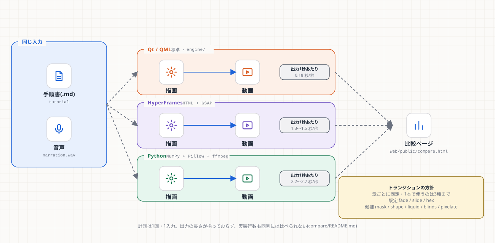

# 第10章 比較実装とトランジション

**学習目標**: ① `compare/` が何のためにあるか説明できる ② 3方式の違いと、標準が Qt のままの理由を言える ③ トランジションが「進み具合の純関数」であることを理解し、新しい種類を足せる

## 10.1 なぜ比較したか

動画の作り方は1つではない。**同じ入力**(手順書 + 音声)から、別の方式で作って、生成時間・サイズ・字幕のずれなどを同じ基準で比べた。



| 方式 | 中身 | 出力1秒あたりの生成時間 | 向き |
|---|---|---|---|
| **Qt / QML**(標準) | `engine/` | 0.18 秒 | 本番。桁違いに速い |
| **HyperFrames** | HTML + GSAP → ヘッドレスブラウザで撮る | 1.3〜1.5 秒 | 見た目の試作・Web 的な演出 |
| **Python** | NumPy + Pillow + ffmpeg | 2.2〜2.7 秒 | GPU・Qt・ブラウザ無しの環境 |

**読み方の注意**(`compare/README.md`): 計測は1回・1入力。出力の長さが揃っておらず(Qt 版は手順書の全章を読む)、実装行数も Qt 版はエンジン全体で、同列には比べられない。BGM は検証用の合成曲。**数字は「桁の違い」を見るもので、順位の根拠にしない**。

## 10.2 `compare/` の構成

```
compare/
├── common/          # 3方式で共有する部品(入力の読み取り・ビート検出・字幕)
├── python_render/   # Python 版の描画(engine.py = 1コマの関数、render.py = 通し、side_by_side.py)
├── hyperframes/     # HTML プロジェクトを作るスクリプト(build_project.py)
├── tests/           # unittest(ビート・パイプライン・トランジション)
├── embed_search.py  # スクリーンショットの検索(V6)
└── publish_compare.py  # 比較ページ用のデータ(web/public/compare/data.js)を作る
```

実行: `cd compare; python -m unittest discover -s tests`(25件)。

## 10.3 ビート検出(V3)

音楽の拍(ビート)に合わせて場面転換したい。numpy だけで拍を検出する(`common/beats.py`)。既知の BPM(90〜150)の合成曲6本で誤差 1.5 BPM 以内。**発話の隙間でだけ**拍に寄せる(声の途中で切り替えない)。

## 10.4 トランジションの考え方

**進み具合 `p`(0〜1)だけで絵が決まる純関数**にする。

```python
def transition(kind, a, b, p):   # a=前の絵, b=次の絵, p=0..1
    if p <= 0: return a          # 端点は厳密に A
    if p >= 1: return b          # 端点は厳密に B
    ...                          # 途中: kind ごとに a と b を混ぜる
```

- **利点**: 同じ `p` で必ず同じ絵(再現できる)。1コマずつ描く方式と相性が良い(時間の状態を持たない)。テストしやすい(端点・途中・純関数性)。
- **しきい値方式**: `mask`(斜めワイプ)・`shape`(円が広がる)・`liquid`(波打つ境界)・`blinds`(ブラインド)・`pixelate`(ブロック)は、「各画素のしきい値(0〜1)」の地図を作り、`p` がそれを超えた画素から B に切り替える。地図は `@lru_cache` で再利用。

```python
wgt = clip((p * (1 + feather) - thr) / feather, 0, 1)   # 画素ごとの B の割合
out = a * (1 - wgt) + b * wgt
```

- **1本の動画で使う種類は3つまで**(`MAX_TRANSITION_KINDS`)。種類が多いと散らかって見えるため。`validate_transition_plan` が、未知の章・種類・4種以上を `ValueError` にする。
- 指定: `--transitions steps=mask,outro=shape`(章 `intro` / `steps` / `outro` に種類を割り当てる)。既定は fade / slide / hex。
- **HyperFrames 版は `mask` と `shape` だけ**(`clip-path` で書けるため)。`liquid` / `blinds` / `pixelate` は1画素ごとの処理が要るので、理由つきで拒否する。

## 10.5 新しいトランジションを足す(要約。詳細は第12章 レシピ5)

1. `python_render/engine.py`: しきい値の関数 `xxx_thresholds(w, h)` を書く(0〜1、`lru_cache`)
2. `SUPPORTED_TRANSITIONS` と `_THRESHOLD_KINDS`(関数とぼかし幅)に登録
3. `compare/tests/test_pipeline.py`: **端点が厳密**・途中で A と B が混ざる・純関数、のテストを足す
4. HyperFrames で書けるなら `HF_SUPPORTED` と `clip-path` を足す。書けないなら**拒否のまま**にして理由を残す
5. p=0.25/0.5/0.75 を並べて目で確認する(コンタクトシート)

## 10.6 比較ページ(`web/public/compare.html`)

2本の動画(A・B)を同期再生する。データは `web/public/compare/data.js`(`publish_compare.py` が作る)。動画本体(`*.mp4` `*.webm`)は大きいので**Git に入れない**(`.gitignore`)。共有ギャラリーのデプロイ時に静的アセットとして上がる。**ローカルのアプリが開く `output/` には、比較ページも動画も置かれない**(そのためリンクは共有ギャラリーでだけ出す: `HAS_COMPARE`)。

## 10.7 未確認

- 新しいトランジション指定での**通しの動画生成**は未実施(単体テストと、8種の目視までの確認)。小さなテスト入力では、元のコードでもエンコーダが途中終了(BrokenPipe)する既存の挙動がある。
- Cube・Page curl・Shatter・Exploded view は未実施(3D 的な表現は、1コマずつ描く方式に別の仕組みが要る)。

## 演習

1. トランジションの関数が `p=1` で `b` と**完全一致**しないと、何が困るか。
2. 新しい `spiral`(渦巻き)を足す。しきい値の地図をどう作るか。
3. 4種類のトランジションを指定すると、どうなるか。

## 解答(例)

1. 切り替え直後の1コマに、前の絵の残りが混ざる(丸め誤差で 254 になるなど)。実際に `p=1` で 254 になる不具合があり、端点は早期 return + 丸め(`np.rint`)で厳密にした。
2. 各画素の「中心からの角度 + 距離」を 0〜1 に正規化した配列にする(`shape` は距離だけ)。`lru_cache` 付きの関数にして、`_THRESHOLD_KINDS` に登録する。
3. `ValueError`(種類は3以内)。章と種類の対応を見直す。
