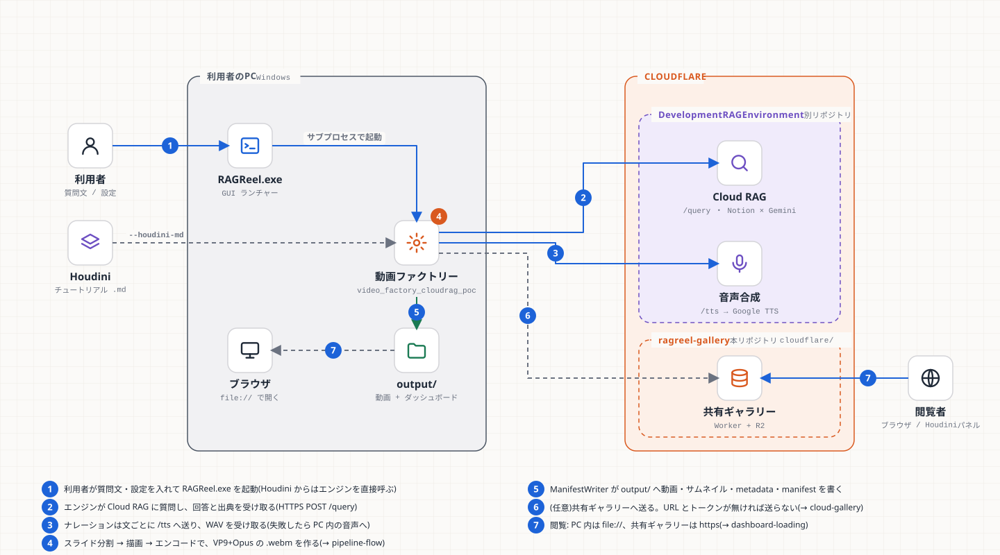

# RAGReel 学習資料 — 基礎から保守・拡張まで

この資料は、**「RAGReel を自分で直せる・育てられる」状態になる**ための講義形式のテキストです。
技術リファレンス([../technical-reference.md](../technical-reference.md))が「何が実装されているか」の事典なのに対して、こちらは「なぜそうなっているか」「どこを触ればどう変わるか」を、基礎から順に説明します。

## 1. このシステムを一言で

> 質問文(またはHoudiniのチュートリアル)を渡すと、**スライド形式・音声ナレーション付き・図解入りの動画**を自動で作り、ギャラリーのWebページに並べるツール。



## 2. 読み方(3つの道)

| あなたの目的 | 読む章 | 目安 |
|---|---|---|
| **全体を理解したい**(初めて触る) | 1 → 2 → 3 → 4 → 5 → 6 → 7 → 8 を順に | 1日 |
| **プログラミングの基礎から** | 15(言語)→ 2 → 3 → 16(アルゴリズム)→ 4 以降 | 2〜3日 |
| **アルゴリズムを理解したい** | 16 → 該当の章(5・6・8・9・10) | 半日 |
| **ビルド・配布・デプロイを触る** | 17 → 9 → 13 | 半日 |
| **画面(Webダッシュボード)だけ直したい** | 1 → 2 → 8 → 9 → 11 → 12 | 半日 |
| **何か壊れた** | 13 → (該当の章) | 随時 |
| **機能を足したい** | 4 → 該当の章 → 12(+ 17) | 半日〜 |

## 3. 章の一覧

| 章 | 内容 | 主な対象 |
|---|---|---|
| [第1章 全体像と用語](01-overview.md) | 何を作っているか。RAG・Worker・ヘッドレス・manifest など最初に要る言葉 | 全員 |
| [第2章 基礎知識](02-fundamentals.md) | プロセス・環境変数・HTTP・JSON・ファイルパス・ビルド・テスト | 初学者 |
| [第3章 動画・音声・字幕の基礎](03-video-basics.md) | フレーム・fps・コーデック・コンテナ・サンプル・時刻 | 初学者 |
| [第4章 エンジンの構造](04-engine-structure.md) | 7段のパイプライン・Orchestrator・GPUリース・DI | C++ を触る人 |
| [第5章 入力と構成](05-input-compose.md) | Cloud RAG・スライド分割3段階・時間配分・Houdini取り込み | C++ を触る人 |
| [第6章 ナレーション](06-narration.md) | 3種の音声・辞書・時刻と字幕 | C++ を触る人 |
| [第7章 描画とエンコード](07-render-encode.md) | ヘッドレスQML・フレーム・FFmpeg・VP9/Opus | C++ を触る人 |
| [第8章 公開とダッシュボード](08-publish-dashboard.md) | manifest・metadata・file:// の制約・app.js・UIルール | Web を触る人 |
| [第9章 共有ギャラリー](09-cloud-gallery.md) | Cloudflare Worker・R2・認証・Range・デプロイ | Web/クラウド |
| [第10章 比較実装とトランジション](10-compare-transitions.md) | 3方式の比較・遷移を足す | Python/Web |
| [第11章 テストと検証](11-testing.md) | どの道具で何を確かめるか・「確認した/していない」の書き方 | 全員 |
| [第12章 拡張レシピ](12-extension-recipes.md) | 「〇〇を足したい」の手順集(8本) | 全員 |
| [第13章 落とし穴とトラブルシュート](13-troubleshooting.md) | 実際に踏んだ問題と切り分け | 全員 |
| [第14章 用語集と総合演習](14-glossary-exercises.md) | 用語・復習問題・総合課題 | 全員 |
| [第15章 言語とスクリプトの基礎](15-language-basics.md) | C++(RAII・所有・並行)・Qt・QML・JavaScript・CSS・Python/numpy・正規表現・シェルを、実コードで | 初学者・全員 |
| [第16章 アルゴリズム編](16-algorithms.md) | 見出し分割・貪欲法・時間配分(固定点反復)・折り返し・Range・ビート検出・トランジション・コントラスト比ほか13本を手計算つきで | 全員 |
| [第17章 ビルド・CI・配布・運用スクリプト編](17-scripts-and-build.md) | CMake・vcpkg・プリセット・バッチ・GitHub Actions・Inno Setup・wrangler・検査ツール・運用の流れ | 全員 |

## 4. この資料の約束事

- **コード参照は `ファイル:関数名`** で書く。行番号は変わるので書かない。実物を開いて確かめること。
- **「確認した」と「未確認」を分けて書く**。この資料の事実は、書いた日(2026-10-30)時点のコードに基づく。食い違ったら**コードが正**で、この資料を直す。
- **演習には答えが付く**(章末)。先に自分で考えてから見ること。
- 図は `docs/diagrams/*.svg`。再生成は `python tools/build_diagrams.py`(第12章)。
- **手計算の数字は、実際に実行して確かめたもの**(第16章)。コードが変わったら、数字も確かめ直すこと。

## 5. 最初の15分(動かしてみる)

APIキーなしで、モック入力から動画を作れる。

```powershell
cmake --preset default
cmake --build --preset default
cd build\engine
.\video_factory_cloudrag_poc.exe "テストトピック" houdini21 --mock
```

終わったら同じフォルダの `output/` に動画(`videos/<id>/video.webm`)と `gallery.html` が出る。`output/gallery.html` をブラウザで開けば、第8章で学ぶダッシュボードが見える。

ここまで動いたら、第1章へ。
